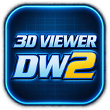
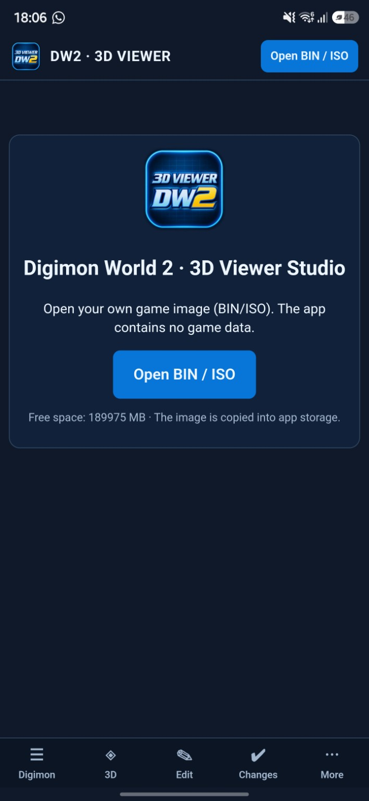
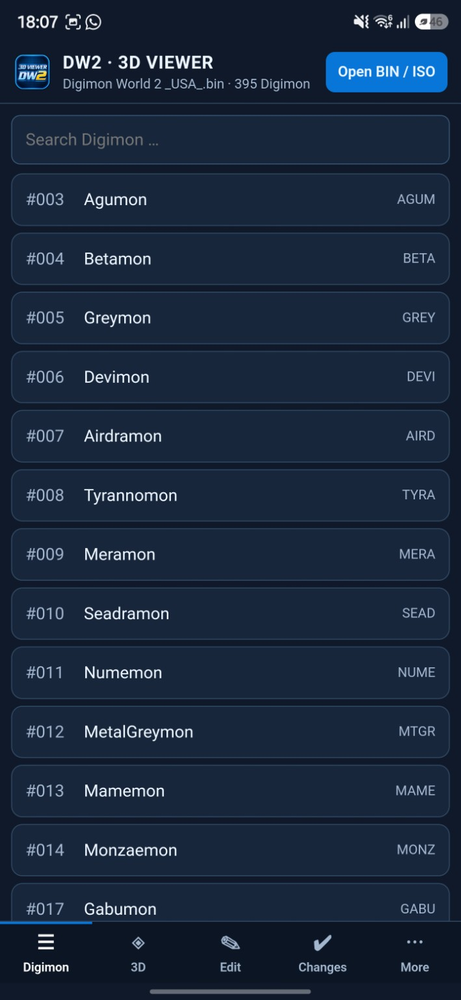
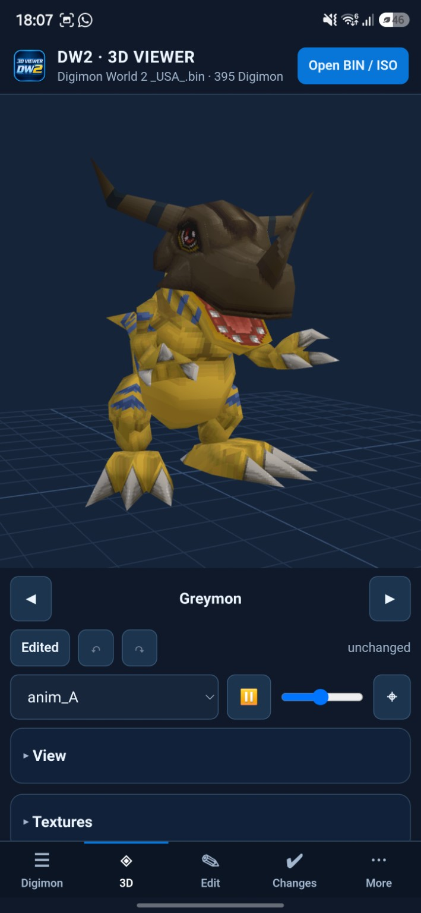
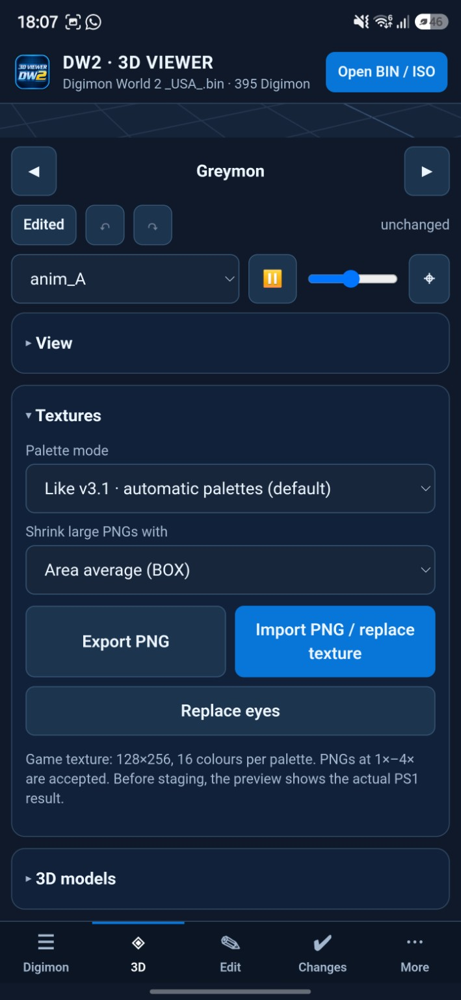
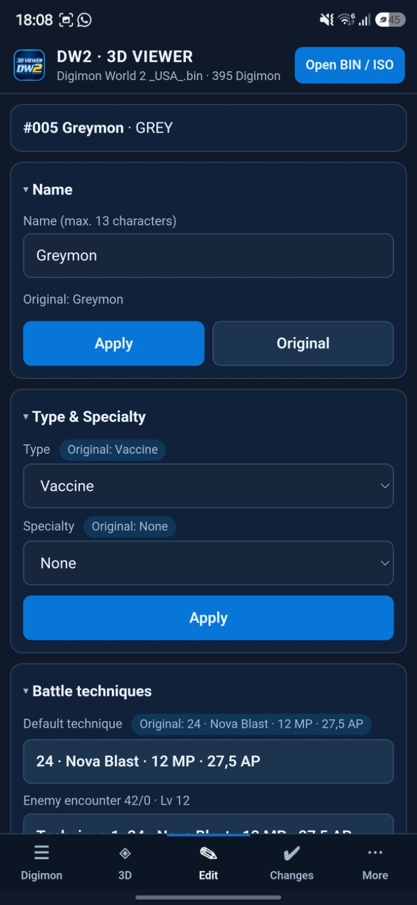
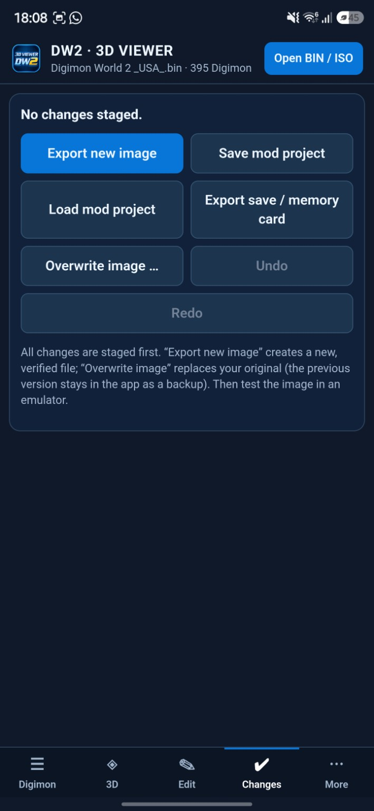

<div align="center">
  

  <h1>DW2 3D Viewer — Android</h1>
  <p><strong>Explore. Animate. Customize.</strong></p>
  <p>A 3D viewer and modding toolkit for Digimon World 2 on PlayStation.</p>

  <p><a href="#english">English</a> · <a href="#deutsch">Deutsch</a> · <a href="#screenshots">Screenshots</a></p>
  <p><a href="https://github.com/emrah1818/dw2-viewer-android/releases/latest">Download APK (v5.1)</a> · <a href="ANLEITUNG.md">Detailed guide / Anleitung</a> · <a href="https://github.com/emrah1818/dw2-viewer-android/issues">Report an issue</a></p>
</div>

## English

### Overview

DW2 3D Viewer brings Digimon World 2 model exploration and editing to Android. Browse Digimon, inspect textured 3D models and animations, customize textures, edit game data, and organize modifications in reusable projects.

**Bring your own game image.** The app contains no game data. Open your own compatible BIN or ISO image to get started. This is a fan project, not an official Digimon or Bandai Namco product.

### Features

| Area | Tools |
| --- | --- |
| Digimon browser | Search and select Digimon from the loaded image. |
| Interactive 3D viewer | Rotate, zoom and pan; select animations, adjust playback speed and reset the camera. Grid, wireframe, pixel look, lighting and background controls are available. |
| Full animation support (v5.1) | Game-accurate playback reconstructed from the game code: 30 fps bone keys with loop points and one-shot holds, eye blinking, texture animations (VRAM copies), PS1 blend modes and animation files shared via MODELDT. Diagnostics per channel and an animation check of all models. See [ANIMATION_ANALYSE.md](ANIMATION_ANALYSE.md). |
| Original background (v5.1) | The animated Digimon World 2 menu background behind the 3D model: dark blue base, DigiCode rows moving in alternating directions, turquoise grid and DW2-style window frames. See [HINTERGRUND_DW2.md](HINTERGRUND_DW2.md). |
| Texture editing | Export PNG textures at 1×–4× scale, preview replacement PNGs, replace eye textures and choose palette/downscaling settings. The v3.1 palette mode is the default. |
| Model exchange | Export GLB/glTF with bones and animations; preview imported GLB/glTF/OBJ files and use the model replacement tools, including bone mapping. |
| Game-data editor | Edit names, type, specialty, battle techniques, enemy statistics and EXP. |
| Save-data editor | Work with save/memory-card values such as HP, MP, attack, defense, speed, EXP and parents. |
| Projects and export | Review staged changes, save/load `.dw2mod` projects, undo/redo, export a new game image and export save data. |
| Languages | English and German interface options. |

**Test-build status:** These tools are documented in the project; availability does not imply that every operation has been verified on an Android device with real game data. See [Validation and limitations](PRUEFUNG_ANDROID_v4_1.md).

### Installation

1. Use an Android **7.0 or newer** device with a supported **64-bit architecture** (`arm64-v8a` or `x86_64`).
2. Open [the latest release (v5.1)](https://github.com/emrah1818/dw2-viewer-android/releases/latest).
3. Download **`DW2_3D_Viewer_v5.1.apk`** from the release assets.
4. Open the APK, allow installation from the downloading app when Android requests it, and install.
5. Have your own BIN/ISO game image ready. Allow approximately **twice the image size** in free storage for opening and **three times** for saving, as advised in the [guide](ANLEITUNG.md).

The download is a prerelease test build. If an updated APK is unavailable, repository owners can run **Actions → Android APK - DW2 3D Viewer → Run workflow** and check the resulting release.

### Quick start

1. Launch the app and select **Open BIN / ISO**. The image is copied into app storage.
2. Open **Digimon**, search for a character and select it.
3. In **3D**, drag with one finger to rotate; use two fingers to zoom/pan. Choose an animation and adjust playback.
4. Expand **Textures** to export a PNG or preview a replacement. Use the model tools for 3D import/export.
5. Open **Edit** to change the available Digimon data.
6. Review **Changes**, save a mod project and export a **new image** when ready. Check the result in a compatible emulator.

### Working with modifications

- Edits are staged before image export. Keep a separate backup of your original image and saves.
- An explicit overwrite option also exists; use it only after reviewing the changes and backup options.
- Imported models must fit the original PS1 model allocation and its geometry, bone and palette limits. Arbitrary modern models cannot be inserted without adaptation.
- Texture imports are converted to the game's palette and resolution constraints; higher-resolution PNG input does not remove those constraints.
- The [validation report dated 2 November 2026](PRUEFUNG_ANDROID_v4_1.md) records synthetic-data tests and browser UI checks. Real-game and Android storage behavior still require practical verification.

### Development

The app combines Kotlin/Android WebView, a Three.js interface and a Python core through Chaquopy. Build configuration: [app/build.gradle.kts](app/build.gradle.kts); automated build: [Android APK workflow](.github/workflows/android-apk.yml).

For local builds, mirror the workflow environment: **JDK 17, Gradle 8.13, Python 3.13, Android SDK platform 36 and build-tools 36.0.0**. Configure your Android SDK path, then run:

```bash
bash tools/fetch_deps.sh
gradle --no-daemon :app:assembleDebug
```

The debug APK is written to `app/build/outputs/apk/debug/`. Core checks:

```bash
python -m pip install numpy pillow
python tests/test_android_api.py
python tests/test_android_edit.py
```

See [THIRD_PARTY.md](THIRD_PARTY.md) for third-party components and notices. When reporting a problem, include the app version, Android version, image format and reproduction steps.

---

## Screenshots

Provided Android screenshots / Bereitgestellte Android-Screenshots.

<table>
  <tr>
    <th>Welcome / Start</th>
    <th>Digimon browser / Liste</th>
    <th>3D &amp; animations / Animationen</th>
  </tr>
  <tr>
    <td></td>
    <td></td>
    <td></td>
  </tr>
  <tr>
    <th>Textures / Texturen</th>
    <th>Editor / Bearbeiten</th>
    <th>Changes / Änderungen</th>
  </tr>
  <tr>
    <td></td>
    <td></td>
    <td></td>
  </tr>
</table>

---

## Deutsch

### Überblick

Der DW2 3D Viewer bringt das Betrachten und Bearbeiten von Digimon-World-2-Modellen auf Android. Durchsuche Digimon, erkunde texturierte 3D-Modelle und Animationen, passe Texturen und Spieldaten an und verwalte deine Änderungen in wiederverwendbaren Mod-Projekten.

**Eigenes Spielabbild erforderlich.** Die App enthält keine Spieldaten. Zum Start benötigst du ein eigenes kompatibles BIN- oder ISO-Abbild. Dies ist ein Fan-Projekt und kein offizielles Produkt von Digimon oder Bandai Namco.

### Funktionen

| Bereich | Werkzeuge |
| --- | --- |
| Digimon-Liste | Digimon im geladenen Spielabbild suchen und auswählen. |
| Interaktiver 3D-Viewer | Drehen, zoomen und verschieben; Animationen auswählen, Tempo ändern und Kamera zurücksetzen. Einstellungen für Raster, Drahtgitter, Pixel-Look, Licht und Hintergrund. |
| Texturbearbeitung | PNG-Export in 1×–4×, Vorschau für Ersatz-PNGs, Augen ersetzen sowie Paletten- und Skalierungsoptionen. Standard ist der Palettenmodus „Wie v3.1“. |
| 3D-Austausch | GLB/glTF mit Knochen und Animationen exportieren; GLB/glTF/OBJ zur Ansicht importieren und Modelle mit den Austauschwerkzeugen einschließlich Knochenzuordnung ersetzen. |
| Spieldaten-Editor | Namen, Typ, Spezialgebiet, Kampftechniken, Gegnerwerte und EXP bearbeiten. |
| Spielstand-Editor | Spielstand-/Memory-Card-Werte wie HP, MP, Angriff, Verteidigung, Tempo, EXP und Eltern bearbeiten. |
| Projekte und Export | Vorgemerkte Änderungen prüfen, `.dw2mod`-Projekte speichern/laden, Schritte rückgängig machen/wiederherstellen sowie neue Spielabbilder und Spielstände exportieren. |
| Sprachen | Deutsche und englische Benutzeroberfläche. |

**Stand: Testversion.** Diese Werkzeuge sind im Projekt dokumentiert. Das bedeutet nicht, dass jede Funktion bereits auf einem Android-Gerät mit echten Spieldaten geprüft wurde. Details stehen im [Prüfbericht](PRUEFUNG_ANDROID_v4_1.md).

### Installation

1. Verwende ein Gerät mit **Android 7.0 oder neuer** und unterstützter **64-Bit-Architektur** (`arm64-v8a` oder `x86_64`).
2. Öffne [das neueste Release (v5.1)](https://github.com/emrah1818/dw2-viewer-android/releases/latest).
3. Lade unter den Release-Dateien **`DW2_3D_Viewer_v5.1.apk`** herunter.
4. Öffne die APK, erlaube bei der Android-Abfrage die Installation durch die herunterladende App und installiere sie.
5. Halte dein eigenes BIN-/ISO-Spielabbild bereit. Die [Anleitung](ANLEITUNG.md) empfiehlt freien Speicher von ungefähr **zweimal der Image-Größe** zum Öffnen und **dreimal der Größe** zum Speichern.

Der Download ist als Vorab-Testversion gekennzeichnet. Falls eine aktuelle APK fehlt, können Repository-Inhaber unter **Actions → Android APK - DW2 3D Viewer → Run workflow** einen Build starten und anschließend das Release prüfen.

### Erste Schritte

1. Starte die App und tippe auf **Open BIN / ISO**. Das Abbild wird in den App-Speicher kopiert.
2. Suche unter **Digimon** einen Charakter und wähle ihn aus.
3. Drehe das Modell unter **3D** mit einem Finger; zoome/verschiebe mit zwei Fingern. Wähle eine Animation und passe das Tempo an.
4. Öffne **Textures / Texturen**, um eine PNG zu exportieren oder einen Ersatz in der Vorschau zu prüfen. Nutze die Modellwerkzeuge für 3D-Import und -Export.
5. Bearbeite unter **Edit / Bearbeiten** die verfügbaren Digimon-Daten.
6. Prüfe **Changes / Änderungen**, speichere dein Mod-Projekt und exportiere ein **neues Spielabbild**. Kontrolliere das Ergebnis in einem kompatiblen Emulator.

### Hinweise für Änderungen

- Änderungen werden vor dem Image-Export vorgemerkt. Bewahre eine separate Sicherung des Originalabbilds und deiner Spielstände auf.
- Eine ausdrückliche Überschreibfunktion ist ebenfalls vorhanden. Prüfe dafür zuerst Änderungen und Sicherungsoptionen.
- Importierte Modelle müssen in den vorhandenen PS1-Modellplatz passen und dessen Grenzen für Geometrie, Knochen und Paletten einhalten. Moderne Modelle benötigen gegebenenfalls Anpassungen.
- Importierte Texturen werden an die Paletten- und Auflösungsgrenzen des Spiels angepasst. Eine größere PNG hebt diese Grenzen nicht auf.
- Der [Prüfbericht vom 2. November 2026](PRUEFUNG_ANDROID_v4_1.md) dokumentiert Tests mit synthetischen Daten und Browser-Oberflächentests. Echte Spielabbilder und das Android-Dateisystem müssen weiterhin praktisch geprüft werden.

### Entwicklung

Die App verbindet Kotlin/Android WebView, eine Three.js-Oberfläche und einen Python-Kern über Chaquopy. Die [Build-Konfiguration](app/build.gradle.kts) und der [APK-Workflow](.github/workflows/android-apk.yml) beschreiben die technische Umgebung.

Für lokale Builds verwende die oben im englischen Abschnitt aufgeführten Voraussetzungen und Befehle. Die Debug-APK liegt anschließend in `app/build/outputs/apk/debug/`.

Weitere Informationen: [Anleitung](ANLEITUNG.md) · [Prüfbericht und Grenzen](PRUEFUNG_ANDROID_v4_1.md) · [Drittanbieter](THIRD_PARTY.md). Gib bei Fehlermeldungen App-Version, Android-Version, Image-Format und Schritte zum Nachstellen an.

