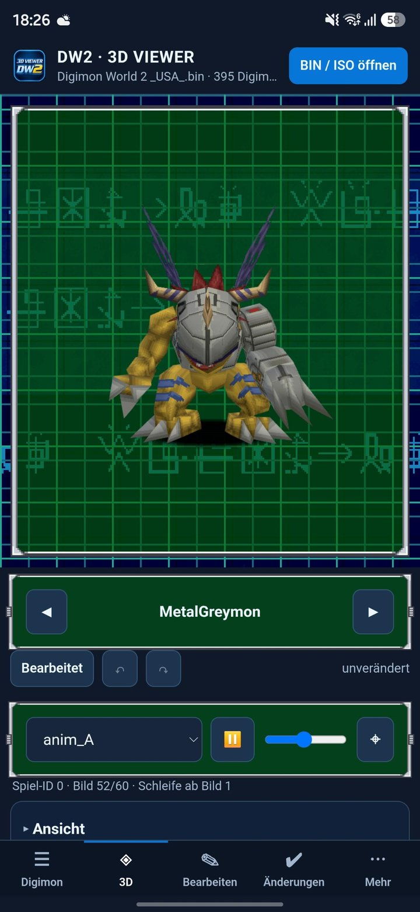
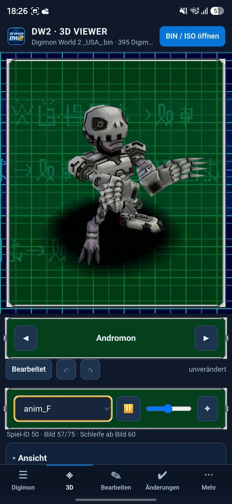
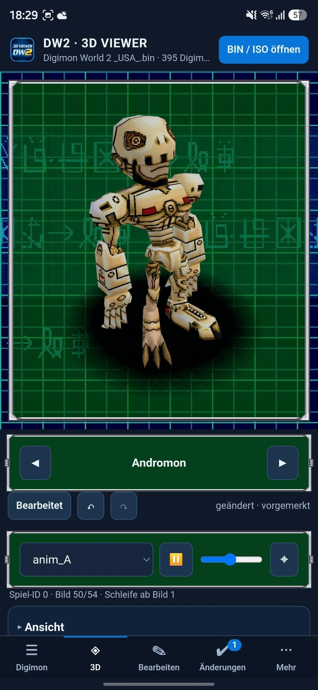
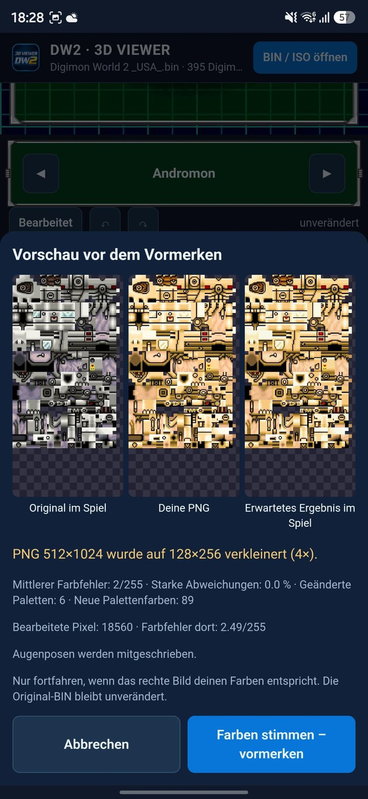
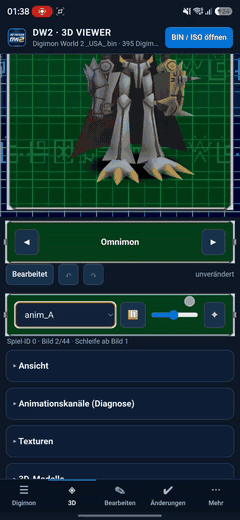
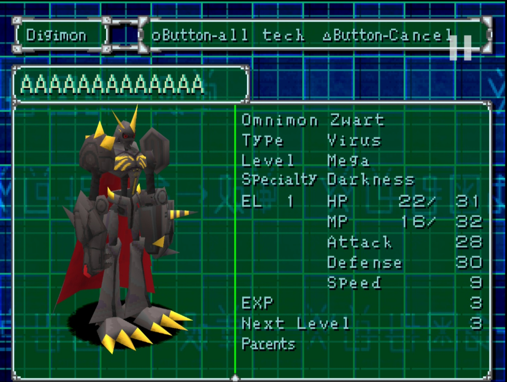

<div align="center">
  

  <h1>DW2 3D Viewer — Android</h1>
  <p><strong>Explore. Animate. Customize.</strong></p>
  <p>A 3D viewer and modding toolkit for Digimon World 2 on PlayStation.</p>

  <p><a href="#whats-new-in-v5">What's new in v5</a> · <a href="#neu-in-v5">Neu in v5</a> · <a href="#modding-example-omnimon-zwart">Modding example</a> · <a href="#modding-beispiel-omnimon-zwart">Modding-Beispiel</a> · <a href="#english">English</a> · <a href="#deutsch">Deutsch</a> · <a href="#screenshots">Screenshots</a></p>
  <p><a href="https://emrah1818.github.io/dw2-viewer-android/"><strong>▶ Open the web version (iPhone · iPad · PC)</strong></a> · <a href="https://emrah1818.github.io/dw2-viewer-android/"><strong>Web-Version starten</strong></a></p>
  <p><a href="https://github.com/emrah1818/dw2-viewer-android/releases/latest">Download APK (v5.2.0)</a> · <a href="ANLEITUNG.md">Detailed guide / Anleitung</a> · <a href="https://github.com/emrah1818/dw2-viewer-android/issues">Report an issue</a></p>
  <p>
    
    
    
  </p>
</div>

## What's new in v5

Version 5 turns the viewer into a faithful reproduction of how Digimon World 2 itself shows its Digimon. Everything below is based on the game's own code (the matching decompilation [Wyrelade/DW2-PC](https://github.com/Wyrelade/DW2-PC)) and on reference captures of the original game.

| Version | What changed |
| --- | --- |
| **5.2** | **Web version** for iPhone, iPad and any desktop browser: https://emrah1818.github.io/dw2-viewer-android/ – same app, no installation. |
| **5.1.2** | The shadow is drawn like in the game: a bright gradient texture **subtracted** from the background, giving a dark centre with a soft edge. |
| **5.1.1** | The original shadow model also loads with its smaller texture; the reason is shown in the diagnostics if it cannot be read. |
| **5.1** | **Green status window** behind the Digimon (semi-transparent green with pixel frame, like the status screen) and the **original shadow** (game model 0x5B) that follows the animation. |
| **5.0** | **Original animated background**: dark blue base, DigiCode rows „デジモンワールド“ moving left/right/left, turquoise grid, DW2 menu-style frames. New adaptive app icon. |
| **4.2** | **Full animation support**: game-accurate 30 fps playback with loop points and one-shot holds, eye blinking with the game's rhythm, texture animations (flames etc.), PS1 blend modes, animations shared between Digimon, no more flickering capes (PS1 back-face culling), animation check of all models. |

### Examples (screenshots above, left to right)

1. **MetalGreymon – original background and shadow.** The model stands in the green status window over the moving DigiCode rows; the dark shadow under its feet is the game's own shadow model and moves with the body.
2. **Andromon – animation F (game ID 50).** The status line under the controls shows game ID, current frame (57/75) and the loop point („Schleife ab Bild 60“): this animation plays an intro once and then loops from frame 60, exactly as stored in the game data. The shadow follows the root bone while Andromon moves.
3. **Andromon – replaced texture.** A recoloured PNG (gold instead of grey) was imported; the model in the viewer immediately shows the result. The status reads „geändert · vorgemerkt“ (changed · staged) and the change appears under **Changes** with a counter, ready to be saved into a new game image.

<p align="center"></p>

4. **Texture replacement preview.** Before anything is staged you see three images side by side: *original in the game*, *your PNG* and the *expected result in the game*. The app reports how it adapted the PNG – here a 512×1024 PNG was reduced 4× to the game's 128×256, the mean colour error is 2/255 with 0.0 % strong deviations, 6 palettes were changed with 89 new palette colours, and the eye poses are written as well. Only if the right-hand image matches your colours do you confirm with *„Farben stimmen – vormerken“*; the original BIN stays untouched.

### Modding example: Omnimon Zwart

A complete mod made on the phone and tested in the real game: Omnimon gets a new black texture, a new name, a new type and specialty, and the result runs in the game.

<table>
  <tr>
    <th>Video (click to play, 69 s)</th>
    <th>Result in the game</th>
  </tr>
  <tr>
    <td align="center"><a href="https://github.com/emrah1818/dw2-viewer-android/raw/main/assets/modding-demo-omnimon.mp4"></a></td>
    <td align="center"></td>
  </tr>
</table>

What happens in the video ([full video, MP4](https://github.com/emrah1818/dw2-viewer-android/raw/main/assets/modding-demo-omnimon.mp4); waiting times are sped up):

1. **Open BIN / ISO** → choose your own *Digimon World 2 (USA)* image.
2. Search **Omnimon** in the Digimon list and open it.
3. **Textures → Import PNG / replace texture** → choose an edited PNG (here a black recolour, 512×1024).
4. Check the **preview before staging** (original · your PNG · expected result) and confirm with *„Farben stimmen – vormerken“*. The model in the viewer turns black right away.
5. **Edit → Name**: rename to *Omnimon Zwart* (max. 13 characters) → *Apply*.
6. **Edit → Type & specialty**: type *Virus* (originally Vaccine), specialty *Darkness* (originally none) → *Apply*.
7. Optionally look at attacks and enemy stats.
8. **Changes** shows the three staged files (texture in `M150OMGM.BIN`, name in `MODELDT0.BIN`, type/specialty in `DIGIMNDT.BIN`) → **Export new image** with a new file name. The original BIN stays untouched.

The screenshot on the right was taken in the game with the exported image: the status screen shows the black Omnimon with the new name, type *Virus* and specialty *Darkness*.

### What you can do with v5

- **Watch every animation as in the game** – choose A–K clips, pause/resume, change speed, see frame and loop information; optional smoothing and repeating of one-shot clips (both marked as not original).
- **Inspect animation channels** – the diagnostics card switches skeleton, texture cycles, extended texture animation, PS1 blend modes and back-face culling on and off and lists eyes, texture animations, blend modes, shared animation files and the shadow status.
- **Check all 395 models** – *More → Animation check* writes a JSON/CSV report of every model's animation data.
- **Replace textures** – import PNGs at up to 4× size, compare original/PNG/expected result, stage the change and export a new image.
- **Export raw files** – export a Digimon's model and assigned animation files as ZIP for analysis.
- **Adjust the look** – original background on/off, background speed, shadow on/off, plain background colour, floor grid, wireframe and pixel look.

## Web version (iPhone, iPad, PC)

**Start it here: [https://emrah1818.github.io/dw2-viewer-android/](https://emrah1818.github.io/dw2-viewer-android/)**

The web version is the same app as the Android version, running fully in the browser (Safari, Chrome, Edge, Firefox). The Python core runs locally through [Pyodide](https://pyodide.org) (WebAssembly).

- **Your game image stays on your device.** It is opened read-only by the browser; nothing is uploaded. The website contains no game data.
- **First start** loads about 30 MB (Python, numpy, Pillow) – afterwards the browser caches it.
- **Add to home screen (iPhone/iPad):** open the link in Safari → Share → *Add to Home Screen*. It then starts full-screen like an app.
- **Open your image:** *Open BIN / ISO* → choose the file from *Files* (iCloud Drive, On My iPhone, …).
- **Exports** (PNG, glTF/OBJ, ZIP, projects, new game image) are offered as downloads; on iPhone they appear in *Files → Downloads*.
- **Limits:** *Overwrite original* is not available (browsers cannot write to the opened file) – use *Export new image* instead. Exporting a complete new image needs a lot of memory; on older iPhones this can fail – a PC/Mac browser or the Android app is more reliable for that step.

## English

### Overview

DW2 3D Viewer brings Digimon World 2 model exploration and editing to Android. Browse Digimon, inspect textured 3D models and animations, customize textures, edit game data, and organize modifications in reusable projects.

**Bring your own game image.** The app contains no game data. Open your own compatible BIN or ISO image to get started. This is a fan project, not an official Digimon or Bandai Namco product.

### Features

| Area | Tools |
| --- | --- |
| Digimon browser | Search and select Digimon from the loaded image. |
| Interactive 3D viewer | Rotate, zoom and pan; select animations, pause, adjust playback speed and reset the camera. Floor grid, wireframe, pixel look, lighting and background controls are available. |
| Full animation support (since v4.2) | Game-accurate playback reconstructed from the game code: 30 fps bone keys with loop points and one-shot holds, eye blinking, texture animations (VRAM copies), PS1 blend modes and animation files shared via MODELDT. Diagnostics per channel and an animation check of all models. See [ANIMATION_ANALYSE.md](ANIMATION_ANALYSE.md). |
| Original background (since v5.0) | The animated Digimon World 2 menu background behind the 3D model: dark blue base, DigiCode rows moving in alternating directions, turquoise grid, the green status window and DW2-style window frames. See [HINTERGRUND_DW2.md](HINTERGRUND_DW2.md). |
| Original shadow (since v5.1) | The game's shadow model under the Digimon, subtractively blended and following the animation. |
| PS1-accurate rendering | Back-face culling like the PlayStation (no flickering capes), PS1 blend modes for semi-transparent parts, transparent black texels on semi-transparent faces. |
| Texture editing | Export PNG textures at 1×–4× scale, preview replacement PNGs, replace eye textures and choose palette/downscaling settings. The v3.1 palette mode is the default. |
| Model exchange | Export GLB/glTF with bones and animations; preview imported GLB/glTF/OBJ files and use the model replacement tools, including bone mapping. |
| Game-data editor | Edit names, type, specialty, battle techniques, enemy statistics and EXP. |
| Save-data editor | Work with save/memory-card values such as HP, MP, attack, defense, speed, EXP and parents. |
| Projects and export | Review staged changes, save/load `.dw2mod` projects, undo/redo, export a new game image and export save data. |
| Languages | English and German interface options. |

**Status:** v5 is the current release. The screenshots above were taken with real game data on an Android phone. Not every operation has been verified with every Digimon; see [Validation and limitations](PRUEFUNG_ANDROID_v4_1.md) and [ANIMATION_ANALYSE.md](ANIMATION_ANALYSE.md) for what is confirmed and what is still open.

### Installation

1. Use an Android **7.0 or newer** device with a supported **64-bit architecture** (`arm64-v8a` or `x86_64`).
2. Open [the latest release (v5.2.0)](https://github.com/emrah1818/dw2-viewer-android/releases/latest).
3. Download **`DW2_3D_Viewer_v5.2.0.apk`** from the release assets.
4. Open the APK, allow installation from the downloading app when Android requests it, and install.
5. Have your own BIN/ISO game image ready. Allow approximately **twice the image size** in free storage for opening and **three times** for saving, as advised in the [guide](ANLEITUNG.md).

Feature branches additionally publish test builds as prereleases. If an updated APK is unavailable, repository owners can run **Actions → Android APK - DW2 3D Viewer → Run workflow** and check the resulting release.

### Quick start

1. Launch the app and select **Open BIN / ISO**. The image is copied into app storage.
2. Open **Digimon**, search for a character and select it.
3. In **3D**, drag with one finger to rotate; use two fingers to zoom/pan. Choose an animation and adjust playback.
4. Expand **Textures** to export a PNG or preview a replacement. Use the model tools for 3D import/export.
5. Open **Edit** to change the available Digimon data.
6. Review **Changes**, save a mod project and export a **new image** when ready. Check the result in a compatible emulator.

### Working with modifications

- Edits are staged before image export. Keep a separate backup of your original image and saves.
- An explicit overwrite option also exists; use it only after reviewing the changes and backup options.
- Imported models must fit the original PS1 model allocation and its geometry, bone and palette limits. Arbitrary modern models cannot be inserted without adaptation.
- Texture imports are converted to the game's palette and resolution constraints; higher-resolution PNG input does not remove those constraints.
- The [validation report dated 2 November 2026](PRUEFUNG_ANDROID_v4_1.md) records synthetic-data tests and browser UI checks. Real-game and Android storage behavior still require practical verification.

### Development

The app combines Kotlin/Android WebView, a Three.js interface and a Python core through Chaquopy. Build configuration: [app/build.gradle.kts](app/build.gradle.kts); automated build: [Android APK workflow](.github/workflows/android-apk.yml).

For local builds, mirror the workflow environment: **JDK 17, Gradle 8.13, Python 3.13, Android SDK platform 36 and build-tools 36.0.0**. Configure your Android SDK path, then run:

```bash
bash tools/fetch_deps.sh
gradle --no-daemon :app:assembleDebug
```

The debug APK is written to `app/build/outputs/apk/debug/`. Core checks:

```bash
python -m pip install numpy pillow
python tests/test_android_api.py
python tests/test_android_edit.py
python tests/test_native_anim.py      # animation, texture animation, shadow (writes a fixture)
node tests/test_native_anim.mjs       # JavaScript playback against that fixture
python tests/e2e_ui.py                # browser UI (needs Playwright + Chromium)
python tests/e2e_anim.py              # browser animation, background, shadow
```

See [THIRD_PARTY.md](THIRD_PARTY.md) for third-party components and notices. When reporting a problem, include the app version, Android version, image format and reproduction steps.

---

## Screenshots

Provided Android screenshots / Bereitgestellte Android-Screenshots.

<table>
  <tr>
    <th>Welcome / Start</th>
    <th>Digimon browser / Liste</th>
    <th>3D &amp; animations / Animationen</th>
  </tr>
  <tr>
    <td></td>
    <td></td>
    <td></td>
  </tr>
  <tr>
    <th>Textures / Texturen</th>
    <th>Editor / Bearbeiten</th>
    <th>Changes / Änderungen</th>
  </tr>
  <tr>
    <td></td>
    <td></td>
    <td></td>
  </tr>
  <tr>
    <th>v5: Background &amp; shadow / Hintergrund &amp; Schatten</th>
    <th>v5: Animation F with loop point / mit Schleifenpunkt</th>
    <th>v5: Replaced texture / Ersetzte Textur</th>
  </tr>
  <tr>
    <td></td>
    <td></td>
    <td></td>
  </tr>
  <tr>
    <th colspan="3">v5: Texture replacement preview / Vorschau beim Texturersatz</th>
  </tr>
  <tr>
    <td colspan="3" align="center"></td>
  </tr>
  <tr>
    <th colspan="3">Modding: Omnimon Zwart in the game / im Spiel</th>
  </tr>
  <tr>
    <td colspan="3" align="center"></td>
  </tr>
</table>

---

## Deutsch

### Web-Version (iPhone, iPad, PC)

**Direkt starten: [https://emrah1818.github.io/dw2-viewer-android/](https://emrah1818.github.io/dw2-viewer-android/)**

Die Web-Version ist dieselbe App wie unter Android und läuft komplett im Browser (Safari, Chrome, Edge, Firefox). Der Python-Kern läuft lokal über [Pyodide](https://pyodide.org) (WebAssembly).

- **Dein Spiel-Image bleibt auf deinem Gerät.** Der Browser öffnet es nur lesend, es wird nichts hochgeladen. Die Website enthält keine Spieldaten.
- **Erster Start** lädt ca. 30 MB (Python, numpy, Pillow), danach nutzt der Browser den Cache.
- **Zum Home-Bildschirm (iPhone/iPad):** Link in Safari öffnen → Teilen → *Zum Home-Bildschirm*. Danach startet sie im Vollbild wie eine App.
- **Image öffnen:** *BIN / ISO öffnen* → Datei aus *Dateien* wählen (iCloud Drive, Auf meinem iPhone …).
- **Exporte** (PNG, glTF/OBJ, ZIP, Projekte, neues Spiel-Image) kommen als Download; auf dem iPhone unter *Dateien → Downloads*.
- **Grenzen:** *Original überschreiben* gibt es nicht (Browser dürfen die geöffnete Datei nicht ändern) – stattdessen *Neues Image exportieren*. Ein komplettes neues Image braucht viel Arbeitsspeicher; auf älteren iPhones kann das scheitern – dafür ist ein PC/Mac-Browser oder die Android-App zuverlässiger.

### Neu in v5

Mit Version 5 zeigt der Viewer die Digimon so, wie Digimon World 2 selbst sie zeigt. Grundlage sind der Spielcode (Decompilation [Wyrelade/DW2-PC](https://github.com/Wyrelade/DW2-PC)) und Aufnahmen aus dem Originalspiel.

| Version | Neu |
| --- | --- |
| **5.2** | **Web-Version** für iPhone, iPad und jeden Desktop-Browser: https://emrah1818.github.io/dw2-viewer-android/ – dieselbe App, ohne Installation. |
| **5.1.2** | Schatten wie im Spiel: die helle Verlaufstextur wird vom Hintergrund **abgezogen** – dunkle Mitte, weicher Rand. |
| **5.1.1** | Das Original-Schattenmodell wird auch mit seiner kleineren Textur geladen; falls nicht, steht der Grund in der Diagnose. |
| **5.1** | **Grünes Statusfenster** hinter dem Digimon (halbtransparent mit Pixelrahmen) und **Original-Schatten** (Spielmodell 0x5B), der der Animation folgt. |
| **5.0** | **Original-Hintergrund**: dunkelblauer Grund, DigiCode-Zeilen „デジモンワールド“ abwechselnd nach links/rechts/links, türkisgrünes Raster, Rahmen im DW2-Menüstil. Neues App-Symbol. |
| **4.2** | **Vollständige Animationen**: 30 Bilder/s wie im Spiel mit Schleifenpunkten und Einmal-Animationen, Blinzeln im Spielrhythmus, Texturanimationen (z. B. Flammen), PS1-Mischmodi, geteilte Animationen, kein Flackern mehr an Umhängen (PS1-Rückseitenverwerfung), Prüfung aller Modelle. |

#### Beispiele (Bilder oben, von links nach rechts)

1. **MetalGreymon – Original-Hintergrund und Schatten.** Das Modell steht im grünen Statusfenster vor den wandernden DigiCode-Zeilen; der dunkle Schatten unter den Füßen ist das Schattenmodell des Spiels und bewegt sich mit.
2. **Andromon – Animation F (Spiel-ID 50).** Die Statuszeile zeigt Spiel-ID, Bild (57/75) und „Schleife ab Bild 60“: Die Animation spielt einmal einen Anfang und wiederholt dann ab Bild 60 – genau wie in den Spieldaten. Der Schatten folgt dem Körper.
3. **Andromon – ersetzte Textur.** Eine umgefärbte PNG (Gold statt Grau) wurde importiert; das Modell zeigt das Ergebnis sofort. Der Status lautet „geändert · vorgemerkt“, unter **Änderungen** erscheint der Zähler – bereit für ein neues Spielabbild.
4. **Vorschau beim Texturersatz** (Bild unten im Abschnitt *Screenshots*). Vor dem Vormerken stehen *Original im Spiel*, *deine PNG* und *erwartetes Ergebnis im Spiel* nebeneinander. Die App zeigt, wie sie die PNG angepasst hat: hier 512×1024 auf 128×256 verkleinert (4×), mittlerer Farbfehler 2/255, 0,0 % starke Abweichungen, 6 geänderte Paletten mit 89 neuen Farben, Augenposen werden mitgeschrieben. Erst wenn das rechte Bild stimmt, bestätigst du mit „Farben stimmen – vormerken“; die Original-BIN bleibt unverändert.

#### Modding-Beispiel: Omnimon Zwart

Ein kompletter Mod, am Handy erstellt und im echten Spiel getestet: Omnimon bekommt eine neue schwarze Textur, einen neuen Namen, neuen Typ und neues Spezialgebiet – und das Ergebnis läuft im Spiel.

<table>
  <tr>
    <th>Video (anklicken zum Abspielen, 69 s)</th>
    <th>Ergebnis im Spiel</th>
  </tr>
  <tr>
    <td align="center"><a href="https://github.com/emrah1818/dw2-viewer-android/raw/main/assets/modding-demo-omnimon.mp4"></a></td>
    <td align="center"></td>
  </tr>
</table>

Ablauf im Video ([ganzes Video als MP4](https://github.com/emrah1818/dw2-viewer-android/raw/main/assets/modding-demo-omnimon.mp4); Wartezeiten sind beschleunigt):

1. **BIN / ISO öffnen** → eigenes Abbild *Digimon World 2 (USA)* auswählen.
2. In der Digimon-Liste **Omnimon** suchen und öffnen.
3. **Texturen → PNG importieren / Textur ersetzen** → bearbeitete PNG wählen (hier schwarz umgefärbt, 512×1024).
4. **Vorschau vor dem Vormerken** prüfen (Original · deine PNG · erwartetes Ergebnis) und mit „Farben stimmen – vormerken“ bestätigen. Das Modell im Viewer wird sofort schwarz.
5. **Bearbeiten → Name**: in *Omnimon Zwart* umbenennen (max. 13 Zeichen) → *Übernehmen*.
6. **Bearbeiten → Typ & Specialty**: Typ *Virus* (original Vaccine), Specialty *Darkness* (original keins) → *Übernehmen*.
7. Optional Attacken und Gegnerwerte ansehen.
8. Unter **Änderungen** stehen drei vorgemerkte Dateien (Textur in `M150OMGM.BIN`, Name in `MODELDT0.BIN`, Typ/Specialty in `DIGIMNDT.BIN`) → **Neues Image exportieren** mit neuem Dateinamen. Die Original-BIN bleibt unverändert.

Der Screenshot rechts stammt aus dem Spiel mit dem exportierten Abbild: Der Statusbildschirm zeigt das schwarze Omnimon mit neuem Namen, Typ *Virus* und Specialty *Darkness*.

#### Was mit v5 möglich ist

- **Alle Animationen wie im Spiel ansehen** – Clips A–K wählen, pausieren, Tempo ändern, Bild und Schleife ablesen; optional Glätten und Wiederholen von Einmal-Animationen (beides als „nicht original“ gekennzeichnet).
- **Animationskanäle prüfen** – die Diagnose-Karte schaltet Skelett, Texturzyklen, erweiterte Texturanimation, Mischmodi und Rückseiten einzeln und zeigt Augen, Texturanimationen, Mischmodi, geteilte Animationsdateien und den Schattenstatus.
- **Alle 395 Modelle prüfen** – *Mehr → Animationsprüfung* schreibt einen JSON-/CSV-Bericht.
- **Texturen ersetzen** – PNG bis 4× importieren, Original/PNG/Ergebnis vergleichen, vormerken, neues Abbild exportieren.
- **Rohdaten exportieren** – Modell und zugeordnete Animationsdateien eines Digimon als ZIP.
- **Aussehen anpassen** – Original-Hintergrund an/aus, Hintergrund-Tempo, Schatten an/aus, einfarbiger Hintergrund, Boden-Raster, Drahtgitter, Pixel-Look.

### Überblick

Der DW2 3D Viewer bringt das Betrachten und Bearbeiten von Digimon-World-2-Modellen auf Android. Durchsuche Digimon, erkunde texturierte 3D-Modelle und Animationen, passe Texturen und Spieldaten an und verwalte deine Änderungen in wiederverwendbaren Mod-Projekten.

**Eigenes Spielabbild erforderlich.** Die App enthält keine Spieldaten. Zum Start benötigst du ein eigenes kompatibles BIN- oder ISO-Abbild. Dies ist ein Fan-Projekt und kein offizielles Produkt von Digimon oder Bandai Namco.

### Funktionen

| Bereich | Werkzeuge |
| --- | --- |
| Digimon-Liste | Digimon im geladenen Spielabbild suchen und auswählen. |
| Interaktiver 3D-Viewer | Drehen, zoomen und verschieben; Animationen auswählen, pausieren, Tempo ändern und Kamera zurücksetzen. Einstellungen für Boden-Raster, Drahtgitter, Pixel-Look, Licht und Hintergrund. |
| Animationen (seit v4.2) | Wiedergabe wie im Spiel nach dem Spielcode: 30 Bilder/s, Schleifenpunkte, Einmal-Animationen, Blinzeln, Texturanimationen, PS1-Mischmodi, geteilte Animationen über MODELDT; Diagnose je Kanal und Prüfung aller Modelle. Siehe [ANIMATION_ANALYSE.md](ANIMATION_ANALYSE.md). |
| Original-Hintergrund (seit v5.0) | Animierter DW2-Menühintergrund mit gegenläufigen DigiCode-Zeilen, türkisgrünem Raster, grünem Statusfenster und Rahmen im Menüstil. Siehe [HINTERGRUND_DW2.md](HINTERGRUND_DW2.md). |
| Original-Schatten (seit v5.1) | Schattenmodell des Spiels unter dem Digimon, subtraktiv gemischt, folgt der Animation. |
| PS1-genaue Darstellung | Nur Vorderseiten wie auf der PlayStation (kein Flackern an Umhängen), PS1-Mischmodi, durchsichtiges Schwarz auf halbtransparenten Flächen. |
| Texturbearbeitung | PNG-Export in 1×–4×, Vorschau für Ersatz-PNGs, Augen ersetzen sowie Paletten- und Skalierungsoptionen. Standard ist der Palettenmodus „Wie v3.1“. |
| 3D-Austausch | GLB/glTF mit Knochen und Animationen exportieren; GLB/glTF/OBJ zur Ansicht importieren und Modelle mit den Austauschwerkzeugen einschließlich Knochenzuordnung ersetzen. |
| Spieldaten-Editor | Namen, Typ, Spezialgebiet, Kampftechniken, Gegnerwerte und EXP bearbeiten. |
| Spielstand-Editor | Spielstand-/Memory-Card-Werte wie HP, MP, Angriff, Verteidigung, Tempo, EXP und Eltern bearbeiten. |
| Projekte und Export | Vorgemerkte Änderungen prüfen, `.dw2mod`-Projekte speichern/laden, Schritte rückgängig machen/wiederherstellen sowie neue Spielabbilder und Spielstände exportieren. |
| Sprachen | Deutsche und englische Benutzeroberfläche. |

**Stand:** v5 ist das aktuelle Release. Die Screenshots oben stammen von einem Android-Handy mit echten Spieldaten. Nicht jede Funktion wurde mit jedem Digimon geprüft; was bestätigt und was offen ist, steht im [Prüfbericht](PRUEFUNG_ANDROID_v4_1.md) und in [ANIMATION_ANALYSE.md](ANIMATION_ANALYSE.md).

### Installation

1. Verwende ein Gerät mit **Android 7.0 oder neuer** und unterstützter **64-Bit-Architektur** (`arm64-v8a` oder `x86_64`).
2. Öffne [das neueste Release (v5.2.0)](https://github.com/emrah1818/dw2-viewer-android/releases/latest).
3. Lade unter den Release-Dateien **`DW2_3D_Viewer_v5.2.0.apk`** herunter.
4. Öffne die APK, erlaube bei der Android-Abfrage die Installation durch die herunterladende App und installiere sie.
5. Halte dein eigenes BIN-/ISO-Spielabbild bereit. Die [Anleitung](ANLEITUNG.md) empfiehlt freien Speicher von ungefähr **zweimal der Image-Größe** zum Öffnen und **dreimal der Größe** zum Speichern.

Feature-Branches veröffentlichen zusätzlich Test-Builds als Vorabversion. Falls eine aktuelle APK fehlt, können Repository-Inhaber unter **Actions → Android APK - DW2 3D Viewer → Run workflow** einen Build starten und anschließend das Release prüfen.

### Erste Schritte

1. Starte die App und tippe auf **Open BIN / ISO**. Das Abbild wird in den App-Speicher kopiert.
2. Suche unter **Digimon** einen Charakter und wähle ihn aus.
3. Drehe das Modell unter **3D** mit einem Finger; zoome/verschiebe mit zwei Fingern. Wähle eine Animation und passe das Tempo an.
4. Öffne **Textures / Texturen**, um eine PNG zu exportieren oder einen Ersatz in der Vorschau zu prüfen. Nutze die Modellwerkzeuge für 3D-Import und -Export.
5. Bearbeite unter **Edit / Bearbeiten** die verfügbaren Digimon-Daten.
6. Prüfe **Changes / Änderungen**, speichere dein Mod-Projekt und exportiere ein **neues Spielabbild**. Kontrolliere das Ergebnis in einem kompatiblen Emulator.

### Hinweise für Änderungen

- Änderungen werden vor dem Image-Export vorgemerkt. Bewahre eine separate Sicherung des Originalabbilds und deiner Spielstände auf.
- Eine ausdrückliche Überschreibfunktion ist ebenfalls vorhanden. Prüfe dafür zuerst Änderungen und Sicherungsoptionen.
- Importierte Modelle müssen in den vorhandenen PS1-Modellplatz passen und dessen Grenzen für Geometrie, Knochen und Paletten einhalten. Moderne Modelle benötigen gegebenenfalls Anpassungen.
- Importierte Texturen werden an die Paletten- und Auflösungsgrenzen des Spiels angepasst. Eine größere PNG hebt diese Grenzen nicht auf.
- Der [Prüfbericht vom 2. November 2026](PRUEFUNG_ANDROID_v4_1.md) dokumentiert Tests mit synthetischen Daten und Browser-Oberflächentests. Echte Spielabbilder und das Android-Dateisystem müssen weiterhin praktisch geprüft werden.

### Entwicklung

Die App verbindet Kotlin/Android WebView, eine Three.js-Oberfläche und einen Python-Kern über Chaquopy. Die [Build-Konfiguration](app/build.gradle.kts) und der [APK-Workflow](.github/workflows/android-apk.yml) beschreiben die technische Umgebung.

Für lokale Builds verwende die oben im englischen Abschnitt aufgeführten Voraussetzungen und Befehle. Die Debug-APK liegt anschließend in `app/build/outputs/apk/debug/`.

Weitere Informationen: [Anleitung](ANLEITUNG.md) · [Prüfbericht und Grenzen](PRUEFUNG_ANDROID_v4_1.md) · [Drittanbieter](THIRD_PARTY.md). Gib bei Fehlermeldungen App-Version, Android-Version, Image-Format und Schritte zum Nachstellen an.

